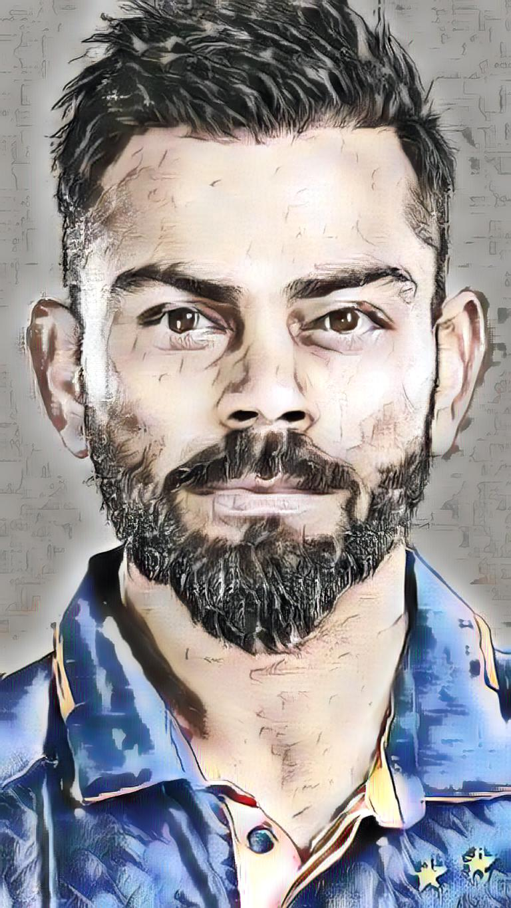
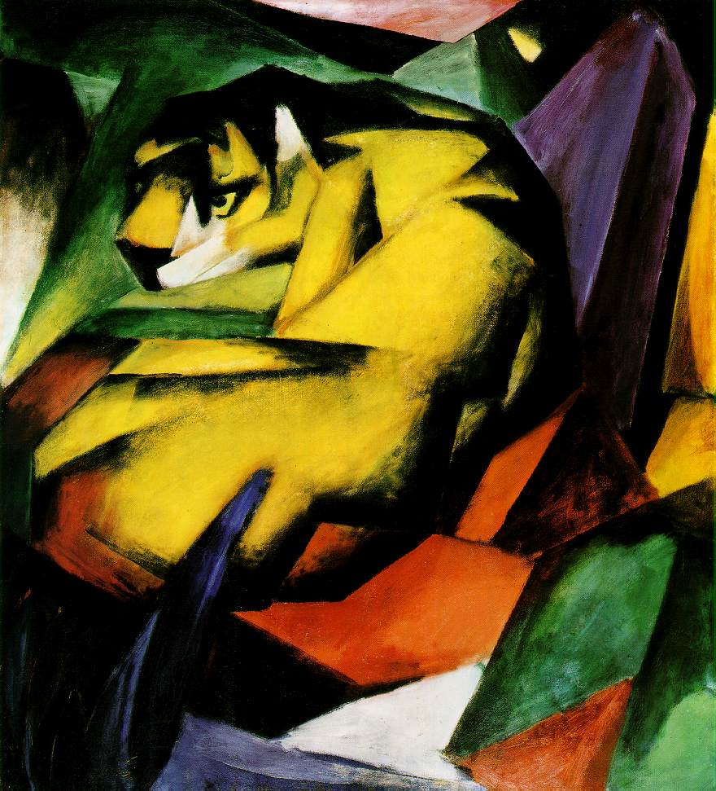
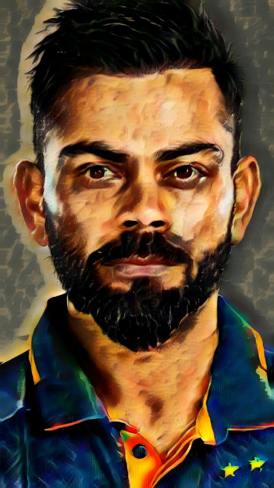

# Prismora AI — Neural Style Transfer Studio

**Transform photographs into artistic images with deep learning.**

Prismora is a browser-based neural style transfer studio built with **Python, Flask, and PyTorch**. It uses **Adaptive Instance Normalization (AdaIN)** to transfer the visual style of a reference image onto the content of another image.

Choose or upload a content photograph, select or upload an artistic style reference, adjust the transfer strength, and generate a stylized image that can be previewed and downloaded.

> **Project focus:**  Deep Learning · Neural Style Transfer · PyTorch · Flask

---

## Architecture overview

The diagram below summarizes the end-to-end workflow: image inputs, VGG feature extraction, AdaIN feature alignment, decoder reconstruction, Flask inference, model asset handling, deployment, and automated quality checks.


---

## Demo preview

The repository includes a built-in example using a portrait as the content image and multiple artistic style references.

| Content image | Style example | Generated result |
|---|---|---|
|  |  |  |
|  |  |  |

---

## Key features

- **Neural style transfer:** combines the structure of a content image with the visual characteristics of a separate style image.
- **Built-in examples and image uploads:** start with the included examples or upload your own PNG, JPG, or JPEG images.
- **Adjustable style strength:** control the transfer from 0 (content-focused) to 1 (full style transfer); the default is 0.65.
- **Result preview and download:** inspect the generated image and download it as a PNG.
- **Responsive browser interface:** access the studio through a web browser.
- **Input validation:** checks file types, image validity, and the 10 MB per-image upload limit.
- **Hardware-aware inference:** selects CUDA, Apple Silicon MPS, or CPU according to runtime availability.
- **Model integrity checks:** model assets can be checked using SHA-256 hashes and retrieved from a configured private S3 bucket.
- **Testing and CI:** includes pytest tests, Ruff linting, and a GitHub Actions workflow.

## How it works

Prismora uses **Adaptive Instance Normalization (AdaIN)** to align feature statistics from a content image with those extracted from a style reference.

```text
 Content image                     Style image
      │                                 │
      ▼                                 ▼
  VGG encoder                       VGG encoder
      │                                 │
      └──────────────┬──────────────────┘
                     ▼
             AdaIN feature alignment
                     │
                     ▼
            Style-strength blending
                     │
                     ▼
              Trained decoder
                     │
                     ▼
              Stylized image
```

The VGG-based encoder extracts image features. AdaIN aligns the channel-wise mean and standard deviation of the content features with those of the style features. The selected strength (`alpha`) blends the transformed and original content features, and the trained decoder reconstructs the output image.

## Technology stack

| Area | Technologies |
|---|---|
| Programming language | Python 3.11 |
| Web framework | Flask |
| Deep learning | PyTorch, Torchvision |
| Core algorithm | Adaptive Instance Normalization (AdaIN) |
| Feature extraction | VGG-based encoder |
| Image processing | Pillow |
| Forms and validation | Flask-WTF, WTForms |
| Training | PyTorch DataLoader, Adam optimizer |
| Production server | Gunicorn |
| Model artifact support | SHA-256 verification, boto3 / private S3 |
| Testing and quality | pytest, Ruff, GitHub Actions |

## Repository structure

```text
Prismora/
├── app.py                       # Flask app, routes, and inference pipeline
├── train.py                     # AdaIN decoder training script
├── model_assets.py              # Model asset download and checksum validation
├── utils/
│   ├── models.py                 # VGG encoder and decoder architectures
│   └── utils.py                  # Dataset, transforms, and AdaIN utilities
├── scripts/
│   └── fetch_model_assets.py     # Model asset preparation helper
├── templates/
│   └── index.html                # Web interface
├── static/
│   ├── examples/                 # Content, style, and result examples
│   └── uploads/                  # Runtime uploads and generated results
├── experiment/
│   └── balanced_v2/              # Trained decoder checkpoints and previews
├── tests/                        # Application and model-asset tests
├── .github/workflows/ci.yml      # Continuous integration workflow
├── requirements.txt
├── requirements-dev.txt
├── Procfile
└── README.md
```

## Run locally

### Requirements

- Python **3.11**
- Git and pip
- Sufficient memory to load the PyTorch model and process images

### 1. Clone the repository

```bash
git clone https://github.com/Devanshyelne/Prismora.git
cd Prismora
```

### 2. Create a virtual environment

macOS / Linux:

```bash
python3.11 -m venv .venv
source .venv/bin/activate
```

Windows PowerShell:

```powershell
py -3.11 -m venv .venv
.venv\Scripts\Activate.ps1
```

### 3. Install dependencies

```bash
python -m pip install --upgrade pip
python -m pip install -r requirements-dev.txt
```

### 4. Configure environment variables

```bash
cp .env.example .env
```

Set a private `FLASK_SECRET_KEY` in `.env` for a persistent Flask session key. Never commit real credentials or secrets.

### 5. Prepare model assets

Inference requires the VGG encoder weights and the trained decoder checkpoint. The application and model-asset helper define the expected model paths and SHA-256 checksums in `app.py` and `model_assets.py`.

Run the repository's asset preparation command:

```bash
python -m scripts.fetch_model_assets
```

When model files are not available locally, the helper supports fetching the configured artifacts from a private S3 bucket. See **Model asset configuration** below. Ensure the decoder path configured for inference and the checkpoint path configured in the asset helper refer to the intended trained weights when changing checkpoints.

### 6. Start the application

```bash
python app.py
```

Open [http://127.0.0.1:5000](http://127.0.0.1:5000) in your browser. The model is loaded on the first style-transfer request; the `/health` endpoint does not load model weights.

## Using the application

1. Select or upload a **content image**.
2. Select or upload a **style image**.
3. Set the style strength using the alpha control.
4. Submit the form to run neural style transfer.
5. Preview the generated result and download the PNG.

Supported upload formats are **PNG, JPG, and JPEG**. Each image may be up to **10 MB**.

## Train the decoder

The repository includes `train.py` for training the AdaIN decoder with separate content and style image folders.

Example training command:

```bash
python train.py \
  --content_dir ./content_data \
  --style_dir ./style_data \
  --vgg ./vgg_normalised.pth \
  --experiment balanced_v2 \
  --epochs 10 \
  --batch_size 8
```

Training artifacts are saved under `experiment/<experiment-name>/`. Depending on the save interval, these include decoder weights, optimizer states, a latest training checkpoint, and preview grids.

To resume from a decoder-only checkpoint, provide the matching optimizer checkpoint when available:

```bash
python train.py \
  --content_dir ./content_data \
  --style_dir ./style_data \
  --vgg ./vgg_normalised.pth \
  --experiment balanced_v2 \
  --resume \
  --decoder_path ./experiment/balanced_v2/decoder_16.pth \
  --optimizer_path ./experiment/balanced_v2/optimizer_16.pth \
  --start_epoch 16 \
  --epochs 4
```

Update dataset and checkpoint paths to match your local setup. Training speed depends on hardware, batch size, and dataset size.

## Model asset configuration

For deployments that retrieve missing weights from private S3 storage, configure the following environment variables:

| Variable | Purpose |
|---|---|
| `MODEL_ASSET_BUCKET` | Private S3 bucket name |
| `MODEL_ASSET_PREFIX` | Object prefix; defaults to `models` |
| `AWS_DEFAULT_REGION` | AWS region containing the bucket |
| `AWS_ACCESS_KEY_ID` | Access key supplied as a deployment secret |
| `AWS_SECRET_ACCESS_KEY` | Secret key supplied as a deployment secret |
| `AWS_SESSION_TOKEN` | Optional temporary credentials token |
| `FLASK_SECRET_KEY` | Flask session secret |

The asset helper verifies downloaded files against the SHA-256 values defined in `model_assets.py` before installing them. Grant the deployment identity only the access it needs to read the model objects. Do not store credentials in source code.

## Tests and code quality

Install the development dependencies, then run:

```bash
python -m compileall -q app.py train.py utils model_assets.py scripts tests
ruff check .
pytest
```

The test suite covers application initialization, the health endpoint, example image availability, upload validation, style-transfer result handling, downloads, and model asset verification. The inference call is mocked in route tests, so those tests do not require a GPU or model download.

GitHub Actions runs the configured Python 3.11 syntax, lint, and test checks on pushes to `main` and pull requests targeting `main`.

## Deployment

The repository includes a `Procfile` that launches the Flask application through Gunicorn and a lightweight `/health` route for platform health checks.

For a Render deployment, configure the repository's `main` branch, install dependencies with:

```bash
pip install -r requirements.txt
```

Use the start command in the repository's `Procfile`, set the health-check path to `/health`, and provide the required model assets and environment variables in the hosting dashboard. A working deployment needs the exact model files expected by the inference code and asset preparation helper.

## Scope

Prismora currently focuses on **image-based neural style transfer**. It is not a text-to-image generation system. Image preprocessing and output resolution are controlled by the inference transforms in `app.py`.

## Author

**Created by [Devansh Yelne](https://github.com/Devanshyelne)**

GitHub: [@Devanshyelne](https://github.com/Devanshyelne)

---

*Prismora — where deep learning meets digital art.*
